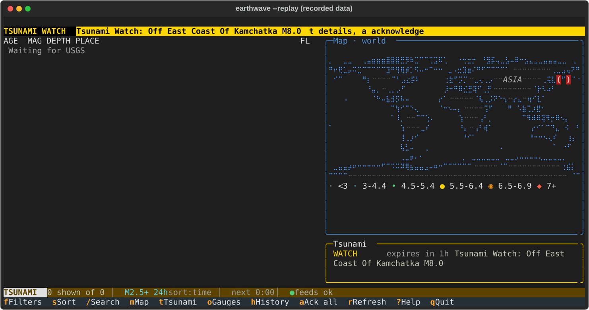
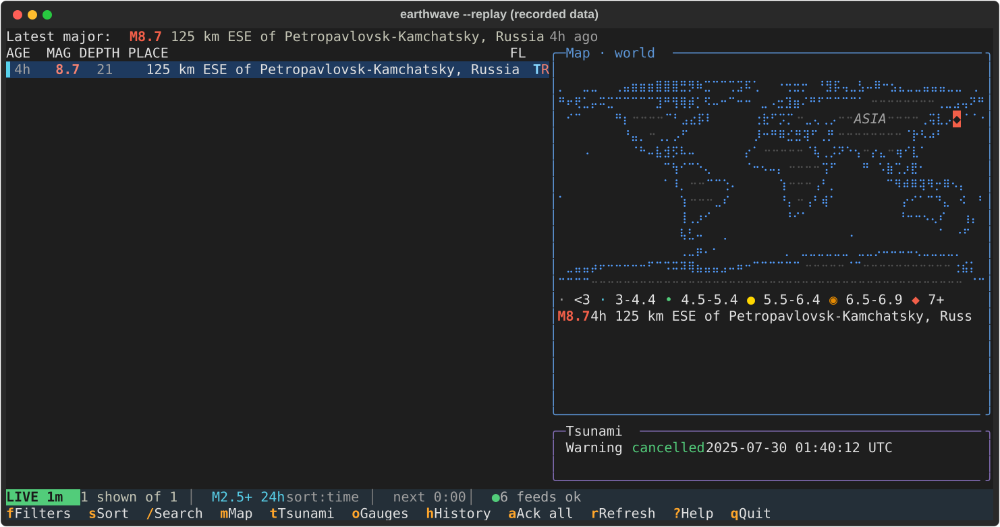
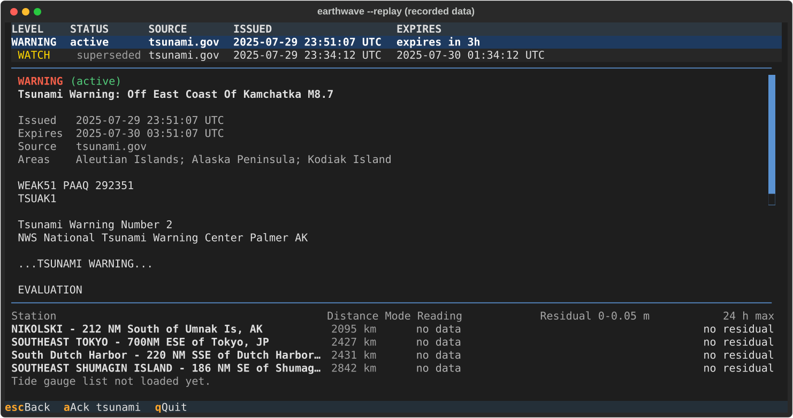

# earthwave

earthwave is a terminal app for following earthquakes and tsunami alerts. It shows live USGS earthquakes in a list, on
a world map and in a detail screen, and it watches the tsunami warning centres and sea-level gauges so you can see an
alert next to what the water is actually doing. It uses only free public feeds that need no key or account.



*Recorded data, not live: the app replaying a saved session with `--replay`.*



This is a 0.x release. It works and is tested, but it is young, and details such as key bindings and the config file may
still change between minor versions. See [`CHANGELOG.md`](CHANGELOG.md).

## Install

Pick one. The commands name release `v0.2.0`, the latest release; they do not build unreleased code.

**With uv** (any Python version; uv fetches Python 3.13 if you lack it):

```
uv tool install --python 3.13 git+https://github.com/WPTK/earthwave.git@v0.2.0
```

**With pipx or pip**, which need Python 3.13 for `v0.2.0` as pinned below (releases after it need Python 3.12 or newer).
On an older Python pip refuses with `requires a different Python`; use uv or the binary instead.

```
pipx install --python python3.13 git+https://github.com/WPTK/earthwave.git@v0.2.0
```

or, inside a virtual environment, `python -m pip install git+https://github.com/WPTK/earthwave.git@v0.2.0`.

**Release binary**, no Python needed. The files are named with the version, so the links below name `v0.2.0` too.
Each release lists them under [Releases](https://github.com/WPTK/earthwave/releases).

- Windows: [`earthwave-v0.2.0-windows-x86_64.exe`](https://github.com/WPTK/earthwave/releases/download/v0.2.0/earthwave-v0.2.0-windows-x86_64.exe).
  Save it in a folder on your `PATH` and rename it to `earthwave.exe`, so that `earthwave` runs it.
- Linux x86-64: [`earthwave-v0.2.0-linux-x86_64.tar.gz`](https://github.com/WPTK/earthwave/releases/download/v0.2.0/earthwave-v0.2.0-linux-x86_64.tar.gz).
  Unpack it and put `earthwave` on your `PATH`:
  `tar -xzf earthwave-v0.2.0-linux-x86_64.tar.gz && mkdir -p ~/.local/bin && install -m 755 earthwave ~/.local/bin/`.
  It is built for glibc 2.35 or newer (Ubuntu 22.04 and later). Alpine and other musl systems are not supported; use uv or pip with Python 3.13 instead.
- macOS arm64: [`earthwave-v0.2.0-macos-arm64.tar.gz`](https://github.com/WPTK/earthwave/releases/download/v0.2.0/earthwave-v0.2.0-macos-arm64.tar.gz),
  unpacked and installed the same way (`~/.local/bin` is not on the macOS `PATH` by default; add it, or use
  `/usr/local/bin`). To clear the Gatekeeper prompt: `xattr -d com.apple.quarantine earthwave`.

Windows: CI runs the tests on GitHub's `windows-2025` runner (Windows Server 2025), and
the app is used by hand on Windows 11 in Windows Terminal. Older Windows versions and the legacy console host are not
tested.

The binaries are not code-signed, so Windows SmartScreen and macOS Gatekeeper will ask you to confirm. Check the
download against `SHA256SUMS` from the same release.

Then check it works:

```
earthwave --version
earthwave --selftest
```

## Run

```
earthwave
```

The first run writes a commented config file to your user config directory. Useful options:

```
earthwave --min-mag 4.5 --hours 72     # what to list
earthwave --home 40.7,-74.0            # distances and near-home alerts
earthwave --glyphs ascii               # for terminals without braille
earthwave --offline                    # no network; browse the saved history
earthwave --record session.jsonl       # save every request ...
earthwave --replay session.jsonl       # ... and play it back later
earthwave --help                       # everything else
```

`--home` applies to that run only. To keep a home, put it in the config file (its path is under "Where files live"):

```toml
[home]
name = "New York"
lat = 40.7
lon = -74.0
```

Setting the home from inside the app is not supported yet. A mistake in the config file is reported with the section
and key it is in, and every mistake is listed at once.

The rest of the flags:

| Flag | Meaning |
| --- | --- |
| `--config PATH` | read this config file instead of the default |
| `--no-config` | ignore the config file and use defaults |
| `--notify` | force toasts and the bell on (they are off under `--replay`) |
| `--speed N` | replay speed multiplier, default 1 (with `--replay`) |
| `--log PATH` | write a rotating log file to PATH (WARNING and above) |
| `--debug` | DEBUG logging to the default log file |
| `--diagnose` | print version, platform, terminal, file paths and feed reachability, then exit; paste it into a bug report |

### Where files live

| | Windows | Linux | macOS |
| --- | --- | --- | --- |
| Config | `%LOCALAPPDATA%\earthwave\config.toml` | `~/.config/earthwave/config.toml` | `~/Library/Application Support/earthwave/config.toml` |
| Log (only with `--log` or `--debug`) | `%LOCALAPPDATA%\earthwave\Logs\earthwave.log` | `~/.local/state/earthwave/log/earthwave.log` | `~/Library/Logs/earthwave/earthwave.log` |
| Saved history | `%LOCALAPPDATA%\earthwave\history.sqlite` | `~/.local/share/earthwave/history.sqlite` | `~/Library/Application Support/earthwave/history.sqlite` |

These come from [platformdirs](https://platformdirs.readthedocs.io/); `XDG_*` variables move the Linux ones. `EARTHWAVE_CONFIG_DIR` (config) and `EARTHWAVE_DATA_DIR` (history, and logs under `logs/`) move them on every OS. Uninstalling earthwave never deletes these directories.

To report a bug, paste the output of `earthwave --diagnose`, run `earthwave --debug`, then open an issue at
[github.com/WPTK/earthwave/issues](https://github.com/WPTK/earthwave/issues) with the version and the end of the log.

Use a terminal at least 100 columns wide and 30 rows tall; below that the app asks you to enlarge the window. The map appears at 120 columns or more.

On a terminal that supports sixel graphics (Windows Terminal 1.22 or later, foot, WezTerm, xterm with sixel) the map is
drawn at pixel resolution. `map_renderer` under `[view]` in the config file is `auto` by default: sixel when the terminal
reports it, braille otherwise (also under `NO_COLOR`, `TERM=dumb`, tmux or screen, a pipe, or a terminal that does not
answer). `braille` or `sixel` forces either. The environment variable `EARTHWAVE_MAP_RENDERER` (`auto`, `braille` or
`sixel`) does the same for one run and wins over the config file.

## Keys

`?` opens the full list. The main ones:

| Key | Action |
| --- | --- |
| `j` `k`, arrows | move in the list |
| `Enter` | quake detail (`b` opens the USGS page, `y` copies its URL) |
| `f` `s` `/` | filters, sort, search |
| `m` `z` | show or hide the map, zoom it |
| `t` | tsunami alerts and bulletins |
| `o` | sea-level gauges |
| `h` | history by day |
| `a` | acknowledge alerts |
| `r` | refresh now |
| `q` | quit |

A tsunami watch, advisory or warning raises a coloured banner across the top, and the status bar changes colour. Major
quakes and new alerts can also raise a desktop notification and a terminal bell.



## Data sources

- [USGS](https://earthquake.usgs.gov/) earthquake feeds and event service
- [NOAA](https://www.noaa.gov/): tsunami.gov bulletins, National Weather Service alerts, NDBC DART buoys and CO-OPS
  tide gauges
- [Japan Meteorological Agency](https://www.jma.go.jp/) tsunami information, used with attribution
- [Natural Earth](https://www.naturalearthdata.com/) coastlines and land polygons, public domain

Requests honour the standard proxy variables (`HTTPS_PROXY`, `HTTP_PROXY`, `NO_PROXY`) and, on Windows, the system proxy
setting.

earthwave identifies itself to every feed, asks whether a copy has changed instead of downloading it again, and backs
off when a feed says to.

**earthwave is not an official tsunami or earthquake warning service and is not affiliated with any of these agencies.
Do not rely on it for safety decisions; follow your local authorities.**

## Checking an install

```
earthwave --version
earthwave --selftest
```

`--selftest` checks that every module imports and renders one screen without a terminal; it also parses the saved sample feeds (the release binary carries them). It prints `selftest: ok` and exits 0 on success. It does not use the network.

## Development

See [`docs/development.md`](docs/development.md) for setup, checks, the release process and the data-capture scripts.

## Licence

[MIT](LICENSE)
