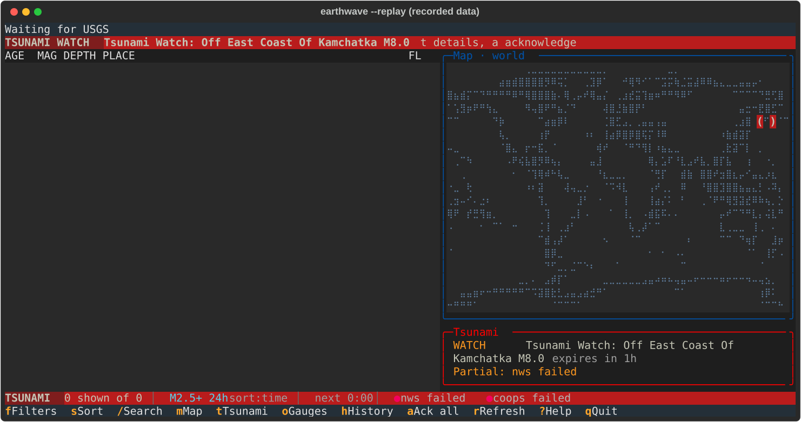
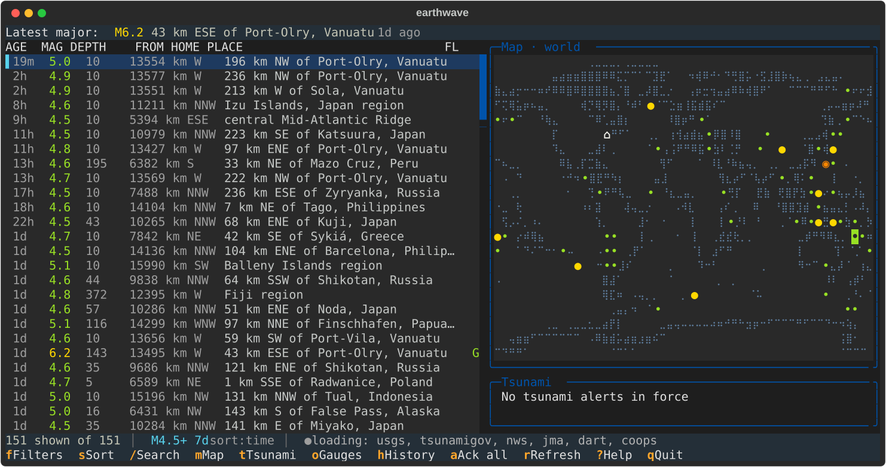
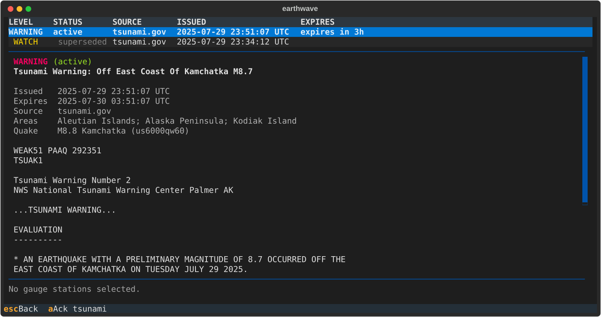

# earthwave

earthwave is a terminal app for following earthquakes and tsunami alerts. It shows live USGS earthquakes in a list, on
a world map and in a detail screen, and it watches the tsunami warning centres and sea-level gauges so you can see an
alert next to what the water is actually doing. It uses only free public feeds that need no key or account.



*Recorded data, not live: the app replaying a saved session with `--replay`.*



This is a 0.x release. It works and is tested, but it is young, and details such as key bindings and the config file may
still change between minor versions. See [`CHANGELOG.md`](CHANGELOG.md).

## Install

Pick one.

- **Release binary.** Download the file for your system from
  [GitHub Releases](https://github.com/WPTK/earthwave/releases) (Windows `.exe`, Linux x86-64 and macOS arm64
  `.tar.gz`). No Python needed. The binaries are not code-signed, so Windows SmartScreen and macOS Gatekeeper will ask
  you to confirm; check the download against `SHA256SUMS` from the same release.
- **From source**, with Python 3.13 or newer:

  ```
  pipx install git+https://github.com/WPTK/earthwave.git
  ```

  or `pip install git+https://github.com/WPTK/earthwave.git` inside a virtual environment.

## Run

```
earthwave
```

The first run writes a commented config file to your user config directory. Useful options:

```
earthwave --min-mag 4.5 --hours 72     # what to list
earthwave --home 40.7,-74.0            # distances and near-home alerts
earthwave --glyphs ascii               # for terminals without braille
earthwave --offline                    # no network; browse the saved history
earthwave --record session.jsonl       # save every request ...
earthwave --replay session.jsonl       # ... and play it back later
earthwave --help                       # everything else
```

Use a terminal at least 100 columns wide and 30 rows tall; below that the app asks you to enlarge the window. The map appears at 120 columns or more.

## Keys

`?` opens the full list. The main ones:

| Key | Action |
| --- | --- |
| `j` `k`, arrows | move in the list |
| `Enter` | quake detail (`b` opens the USGS page, `y` copies its URL) |
| `f` `s` `/` | filters, sort, search |
| `m` `z` | show or hide the map, zoom it |
| `t` | tsunami alerts and bulletins |
| `o` | sea-level gauges |
| `h` | history by day |
| `a` | acknowledge alerts |
| `r` | refresh now |
| `q` | quit |

A tsunami watch, advisory or warning raises a coloured banner across the top, and the status bar changes colour. Major
quakes and new alerts can also raise a desktop notification and a terminal bell.



## Data sources

- [USGS](https://earthquake.usgs.gov/) earthquake feeds and event service
- [NOAA](https://www.noaa.gov/): tsunami.gov bulletins, National Weather Service alerts, NDBC DART buoys and CO-OPS
  tide gauges
- [Japan Meteorological Agency](https://www.jma.go.jp/) tsunami information, used with attribution
- [Natural Earth](https://www.naturalearthdata.com/) coastlines and land polygons, public domain

earthwave identifies itself to every feed, asks whether a copy has changed instead of downloading it again, and backs
off when a feed says to.

**earthwave is not an official tsunami or earthquake warning service and is not affiliated with any of these agencies.
Do not rely on it for safety decisions; follow your local authorities.**

## Checking an install

```
earthwave --version
earthwave --selftest
```

`--selftest` checks that every module imports and renders one screen without a terminal; from a source checkout it also
parses the saved sample feeds. It prints `selftest: ok` and exits 0 on success. It does not use the network.

## Development

See [`docs/development.md`](docs/development.md) for setup, checks, the release process and the data-capture scripts.

## Licence

[MIT](LICENSE)
