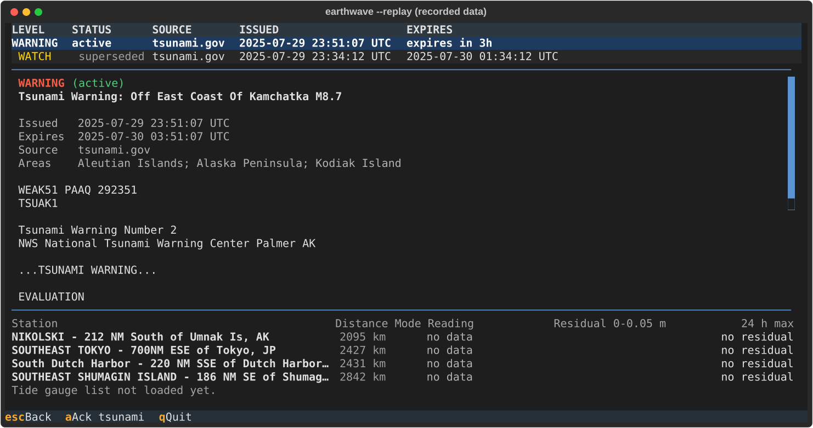

# Features

## Aftershock groups

`g` nests the quakes that look like an aftershock sequence under their mainshock, collapsed to one row marked `[+3]`
(three aftershocks); `Space` opens it (`[-3]`) and closes it again. Grouping is off by default, and the map still shows
every quake. Only the quakes the filters let through are grouped.

The rule is Gardner and Knopoff (1974). A quake is an aftershock of a larger one if it comes after it, is smaller, and
falls within both of these of the larger quake's magnitude `M`:

- time: `10^(0.5409 M - 0.547)` days, or `10^(0.032 M + 2.7389)` days from M 6.5 up
- distance: `10^(0.1238 M + 0.983)` km

Quakes are taken biggest first (ties: the earlier, then the id), so each quake is in at most one group and an aftershock
is never itself a mainshock. The code is `earthwave/state/clusters.py`.

A new aftershock stays unseen until its group is opened or acknowledged with `a`. How the status bar counts quakes
inside a folded group has not been checked against this description.

## Tsunami alerts and notifications

A tsunami watch, advisory or warning raises a coloured banner across the top, and the status bar changes colour. `t`
opens the alerts and their bulletins; `o` opens the sea-level gauges. A DART buoy or tide gauge whose reading departs
from its expected level by at least `gauge_anomaly_dart_m` or `gauge_anomaly_gauge_m` metres raises a gauge-anomaly
alert (see [`configuration.md`](configuration.md)).

Quakes at or above `major_magnitude`, quakes within `radius_km` of home at or above `near_home_magnitude`, and new
alerts can raise a desktop notification and a terminal bell. `[notify]` turns each off. Notifications are off under
`--replay` unless `--notify` is given.

## Record and replay

`--record session.jsonl` appends every HTTP exchange to a file. `--replay session.jsonl` serves that file instead of the
network and advances a replay clock, so a recorded Watch, Warning and Cancellation plays back in seconds with
`--speed 20`. `--record` and `--replay` cannot be combined with each other, and `--offline` cannot be combined with
either.

## History and offline

earthwave saves the quakes it sees in `history.sqlite` (see "Where files live" in
[`configuration.md`](configuration.md)) and keeps `retain_days` days of them. `h` shows the history by day. With
`--offline` nothing is fetched and the app browses the saved history; it says so on screen. The last run's tsunami
bulletins are shown as past products, never as in force.
